<!-- ===================== HEADER ===================== -->

<h1 align="center">Hi, I'm Amir 👋</h1>

  

  

---

<h2 align="center">About Me</h2>

  I'm Amir — interested in programming, technology and building useful projects.
   
  Always learning. Always building.

---

<h2 align="center">GitHub Statistics</h2>

  <picture>
    <source
      media="(prefers-color-scheme: dark)"
      srcset="./assets/overview.dark.svg"
    />
    
  </picture>

  <picture>
    <source
      media="(prefers-color-scheme: dark)"
      srcset="./assets/languages.dark.svg"
    />
    
  </picture>

---

<h2 align="center">Activity History</h2>

  <picture>
    <source
      media="(prefers-color-scheme: dark)"
      srcset="./assets/lifetime.dark.svg"
    />
    
  </picture>

---

<h2 align="center">Contribution Snake 🐍</h2>

  <picture>
    <source
      media="(prefers-color-scheme: dark)"
      srcset="https://raw.githubusercontent.com/z5git/z5git/output/github-snake-dark.svg"
    />
    <source
      media="(prefers-color-scheme: light)"
      srcset="https://raw.githubusercontent.com/z5git/z5git/output/github-snake.svg"
    />
    
  </picture>

---

  Designed with simplicity. Built with curiosity.

  <a href="https://github.com/z5git">github.com/z5git</a>

